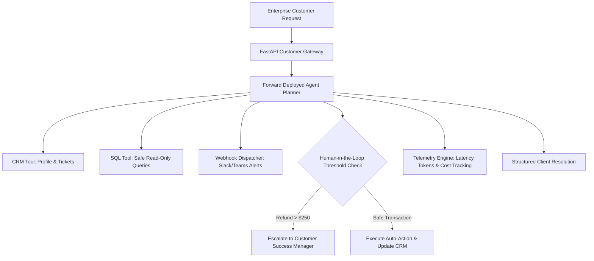

# DeployAgent-FDE: Enterprise Forward-Deployed AI Agent & Workflow Platform

[](https://www.python.org/)
[](https://fastapi.tiangolo.com/)
[](LICENSE)
[](tests/)

**DeployAgent-FDE** is a production-grade Forward-Deployed AI Agent platform tailored for enterprise customer onboarding, CRM/ERP tool orchestration, and automated workflow resolution. Built specifically to demonstrate Forward Deployed Engineering (FDE) capabilities in Generative AI, it bridges customer software with LLM tool-calling orchestration.

---

## Architecture Flow



---

## Key Engineering Capabilities
1. **Multi-Tool Orchestration**: Seamless integration with CRM (Salesforce/HubSpot model), read-only SQL operational databases, and asynchronous Webhook alerting.
2. **Human-in-the-Loop (HITL) Policy Gates**: High-risk financial operations automatically trigger supervisor escalation while low-risk inquiries resolve instantly.
3. **Enterprise Telemetry & Observability**: Real-time token usage, per-session dollar cost tracking, and execution tracing.
4. **Resilience & Circuit Breaker**: Fallback model routing and safe error handling.

---

## Quickstart Guide

```bash
# Install dependencies
pip install -r requirements.txt

# Run unit tests
python3 -m unittest discover -s tests -p "test_*.py" -v

# Run interactive customer integration demo
python3 scripts/run_fde_demo.py

# Start API service
uvicorn src.api.app:app --host 0.0.0.0 --port 8001 --reload
```
